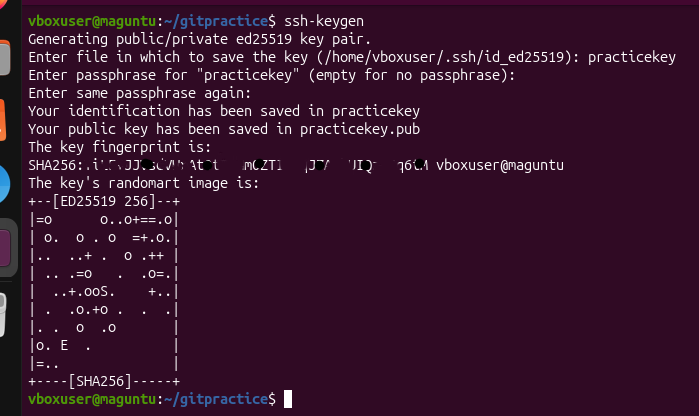
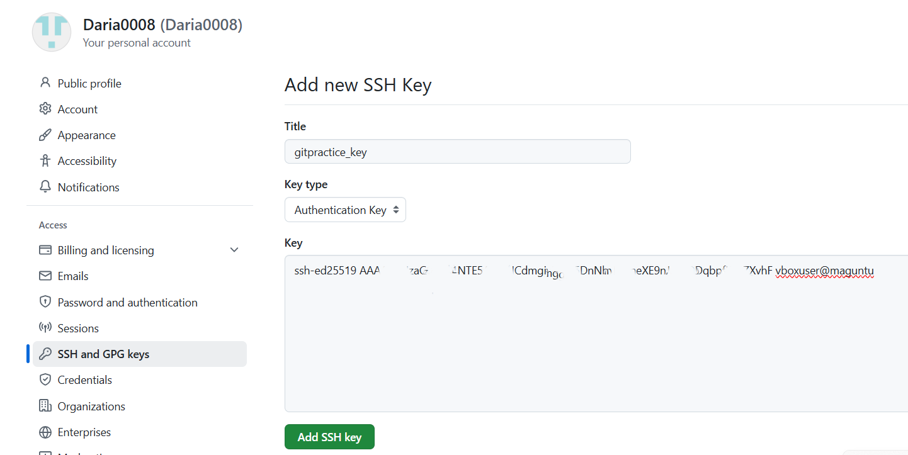
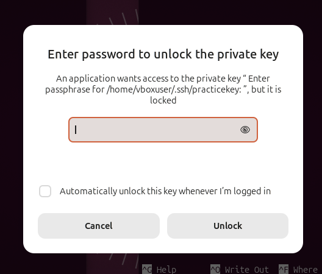
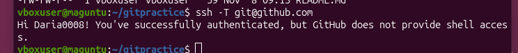
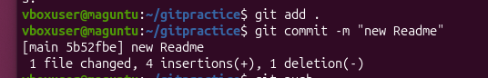
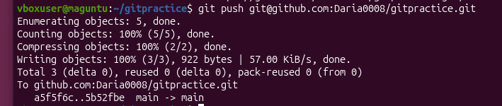

1. Для генерации ключа воспользуемся командой ssh-keygen. Поскольку мы вызвали утилиту в папке gitpractice, то ключ будет создан в ней же.
По умолчанию шифрование для ключа представлено алгоритмом ed25519 - оставим его. Введем название файла, куда будет сохранен ключ, у нас это practicekey. Публичный ключ будет сохранен в файл с таким же названием и расширением .pub. Зададим пароль для ключа, подвердим его повторным вводом - и наша пара ключей готова!
Поскольку мы создавали ключи не в папке ~/.ssh, скопируем их в нее через команду cp для корректной работы ключей

2. Для работы Git с нашим ключом добавим публичный ключ с расширением .pub в настройки аккаунта и сохраним

3. Проверим работу с помощью команды ssh -T git@github.com, введем пароль от ключа и получим приветствие и подтверждение аутентификации

4. Создадим новый коммит для README.md и отправим его в наш репозиторий по ssh

